  

<samp>

  <strong><H2>Hii, I'm Sandeep</H2></strong>
   MERN Stack Developer | Frontend to Backend | Always Building

</samp>

---

<samp>
<h2 align="left">About Me</h2>

So here's the chai ☕ I'm a Full Stack Developer who enjoys turning random ideas into actual working products. I spend my time jumping between frontend pixels, backend logic, databases, and occasionally wondering why something worked five minutes ago but doesn't anymore.

I blend JavaScript, React, Node.js, MongoDB, and a questionable number of open browser tabs to build things that actually work. I love getting my hands dirty with backend engineering, exploring system architecture, and figuring out what happens under the hood.

My days basically go: dream up an idea → write some code → break everything → stare at the terminal → fix the bug → discover three new bugs → repeat until it works. And when it finally does, obviously, it was all part of the plan.

Permanently curious, aggressively hands-on, and always building something. Powered by coffee, curiosity, late-night debugging sessions, and the belief that every problem has a solution (even if it takes 47 Stack Overflow tabs to find it). 🚀

</samp>

---
<samp>
  
### Core Languages

### Backend Architecture & Databases

### Frontend Engineering & UI

### DevOps, System Control & Automation

### OS & Development Environments

---

<h2 align="left">Featured Projects</h2>

<h3>💠 Style Hub</h3>

A modern web platform focused on style and fashion, designed with a clean interface and an engaging browsing experience.

**Key Highlights:**
- **Modern UI:** Clean and visually appealing interface.
- **User Experience:** Responsive and intuitive browsing experience.
- **Design:** Modern layouts with attention to visual details.
- **Web Experience:** Designed to make style discovery engaging.

**Tech Stack:**

  

  <a href="https://style-hub-nine-taupe.vercel.app/">Live Demo ↗</a> ·
  <a href="https://github.com/SandeepKumarBarik/StyleHub">Source Code ↗</a>

---

<h3>💠 Real-Time Chat Application</h3>

A full-stack real-time messaging application built using the MERN stack, designed to provide seamless communication between users through an interactive chat interface.

**Key Features:**
- **Real-Time Messaging:** Instant communication between users.
- **User Authentication:** Secure user registration and login.
- **Chat Management:** Organized messaging experience.
- **Responsive Interface:** Clean and user-friendly design.
- **Full Stack Architecture:** React frontend connected to Node.js and Express APIs.

**Tech Stack:**

  

  <a href="YOUR_CHAT_LIVE_URL">Live Demo ↗</a> ·
  <a href="https://github.com/SandeepKumarBarik/Chat-Application">Source Code ↗</a>

---

<h3>💠 URL Shortener</h3>

A full-stack URL shortening application that transforms lengthy URLs into compact, shareable links. Built with a React frontend and Node.js backend, with MongoDB handling URL data storage.

**Key Features:**
- **URL Shortening:** Convert long URLs into shorter, manageable links.
- **Redirection:** Redirect users from short URLs to their original destinations.
- **Database Management:** Store and retrieve shortened URL records using MongoDB.
- **RESTful APIs:** Handle URL creation and redirection through Express.
- **Responsive UI:** Simple interface for managing shortened links.

**Tech Stack:**

  

  <a href="YOUR_URL_LIVE_URL">Live Demo ↗</a> ·
  <a href="https://github.com/SandeepKumarBarik/Url-Shortner-Website">Source Code ↗</a>

---

<h2 align="left"> Connect With Me</h2>

  
  
  

---

<h2 align="left">Commit Activity</h2>
<picture>
  <source media="(prefers-color-scheme: dark)"
    srcset="https://raw.githubusercontent.com/SandeepKumarBarik/SandeepKumarBarik/output/pacman-contribution-graph-dark.svg"/>
  <source media="(prefers-color-scheme: light)"
    srcset="https://raw.githubusercontent.com/SandeepKumarBarik/SandeepKumarBarik/output/pacman-contribution-graph.svg"/>
  
</picture>

---

<h2 align="center">Quote</h2>

  <em>"Think big. Code smart. Stay humble."</em>
   
  — Sandeep

<samp>
